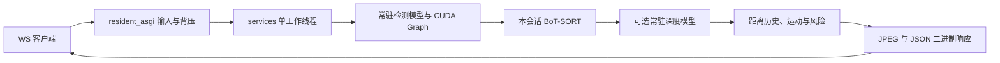

# 本机／自有服务器常驻 GPU 服务

入口 `config.resident_asgi:application` 在 ASGI startup 加载一次 GPU 模型；视频连接通过 `/ws/detect/resident/` 直接进入进程内工作线程，省去 HF 分配和 worker 回环 HTTP 交接。原入口 `config.asgi:application` 保持现有行为。

## Native depth backend

Set `PRS_DEPTH_BACKEND=tensorrt` and `PRS_DEPTH_ENGINE_MANIFEST` before startup to use the
verified FP32 depth engine pool in this resident entry. The same selection is available in PRF2.
See [Depth deployment](DEPTH-EXPORT.md) for dependencies, artifact provenance, supported tensor
shapes and measured gains. A missing/stale engine or unsupported shape fails explicitly; Torch
remains the unconfigured backend. Session and frame metadata expose `depth_backend` separately
from detection's execution identity. Shape coverage and truth-based accuracy require independent
validation on the deployment inputs.

## 结构与优化工作入口

| 目录／文件 | 职责 | 推理优化关注点 |
| --- | --- | --- |
| `config/` | Django 设置、HTTP/ASGI 装配 | 常驻启动、单进程部署、Origin/Host 配置 |
| `core/` | HTTP/WS 适配、原 HF 转发、图像工具、地图和 VLM | 输入契约、排队、JPEG 编解码、外部 API 耗时 |
| `realtime/services.py` | 常驻模型、工作线程、会话所有权 | 模型一次加载、取消后等待真实推理完成 |
| `realtime/resident_asgi.py` | 新常驻二进制 WS 适配 | 顺序、12 帧背压、停止排空、忙碌拒绝 |
| `realtime/detector.py` | 单帧完整流水线 | 预处理 → 检测 → 跟踪关联 → 深度融合 → 运动/风险 → JPEG |
| `realtime/depth.py` | YOLO26 Depth 与框内深度统计 | 深度 forward、设备内 ROI 归约、CPU/GPU 同步 |
| `realtime/tracking.py`、`risk.py` | BoT-SORT、距离历史、TTC 和风险规则 | 每视频会话独立状态、时间戳、帧处理开销 |
| `zerogpu/runtime.py` | 检测模型装载及 CUDA Graph | 常驻张量、固定尺寸输入、FP32、搬运与计算计时 |
| `zerogpu/` 其余文件 | 原 HF Space、分配与 worker 传输 | 原部署兼容；不再是新常驻链路的必经路径 |
| `models/` | 模型 manifest、旧部署方案、本地权重 | SHA 身份与运行参数；权重 Git ignored |
| `tools/`、`model_tests/` | 基准、模型与质量验证 | 原始帧记录、首帧/稳态分离、数值与质量门槛 |
| `benchmarks/`、`notebooks/` | 基准证据及历史实验 | 区分硬件、工作负载和诊断／质量评估 |
| `../frontend/` | 摄像头采集、显示、客户端协议 | 显式 Echo/HF/常驻选择，分别校验 HF 和 resident-v1 准入 |



## 启动

使用已准备的 Python 3.12 环境、本机 CUDA、`requirements-depth.txt` 依赖及经 manifest 验证的官方权重。服务不自动下载、不切换 CPU、不重试。`RESIDENT_MODE` 可为 `detection`、`depth`、`full`，默认 `full`；分别对应仅检测、检测加深度、检测加深度/跟踪/风险。它们是显式工作负载，不是运行时降级等级。

在 `backend/`，先按 README 配置 `.env` 中的 `DJANGO_SECRET_KEY`。不要覆盖已有 `.env`。本机启动：

```powershell
$env:RESIDENT_MODE = 'full'
$env:YOLO_CONFIG_DIR = "$PWD\.venv\ultralytics"
$env:YOLO_AUTOINSTALL = 'false'
$env:MPLCONFIGDIR = "$PWD\.venv\matplotlib"
New-Item -ItemType Directory -Force $env:YOLO_CONFIG_DIR, $env:MPLCONFIGDIR | Out-Null
.\.venv\Scripts\python.exe -m uvicorn config.resident_asgi:application --host 127.0.0.1 --port 8766 --workers 1 --lifespan on --ws websockets-sansio --ws-max-size 1310728 --ws-max-queue 12 --ws-per-message-deflate false
```

一次启动只构建一个检测模型和一个可选深度模型；检测 Graph 在第一张真实图片上捕获，之后跨会话复用。首帧仍需支付捕获与 SDK 初始化成本，没有用人工暖机结果隐藏该成本。深度 Graph 实验尚未接入服务。

部署到自有服务器时，显式选择对应 Django 配置和精确的 `CAMERA_ALLOWED_ORIGINS`／`ALLOWED_HOSTS`，使用 HTTPS/WSS 反向代理。与既有摄像头诊断端点一样，本接口按 Origin/Host 校验，不是产品账号认证；当前没有多租户用户鉴权。不要通过增加 Uvicorn workers 来扩容同一 GPU：模型和 admission 都是进程内状态。

## 会话与协议

- 地址：`ws://127.0.0.1:8766/ws/detect/resident/`，Origin 必须为配置的同源地址，Host 必须一致，不接受查询参数。
- 首条 JSON：`kind=session`、`protocol=resident-v1`，实际模型 SHA／FP32 身份、工作负载、`max_inflight=12`、`idle_seconds=15`、`session_seconds=null`。不宣称继承 HF FP16 的 COCO 验证成绩。
- 输入复用 `realtime.protocol.pack_request(index, jpeg)`：`PRF1` + 网络序 uint32（从 0 连续递增）+ JPEG；最多 1 MiB、最大边 640，原 JPEG80/阈值 0.25 保持。
- 输出复用 `unpack_result(packet, expected_index)`：`PRS1` + JSON 字节数 + metadata + JPEG。新增 `resident_queue_ms` 是本机接收至提交执行的等待时间，`server_ms` 包含单帧流水线；阶段计时存在包含关系，不能直接相加。
- 深度启用时，`depth_ms = decode_boxes_ms + depth_predict_ms + depth_fusion_ms`，分别记录框解析、深度调用及距离融合的主机耗时。融合包含策略/缓存管理；共享流水线的 C 模式跳过深度时，预测子计时为零。没有额外 CUDA 同步，异步设备等待可能落在后续阶段；这些字段不能当成纯 GPU kernel 时间。
- 12 帧限制包含已接收但尚未发送完成的全部帧。客户端应在完整收到一帧后释放 credit；超过窗口或乱序直接失败，不丢帧、不重试。
- 正常停止发送精确文本 `{"kind":"stop"}`。服务排空已接收帧，再返回 `kind=ended` 及 `received/delivered`，最后正常关闭。断连则停止后续排队帧，等待已经进入工作线程的推理完成，再释放槽位。
- 一个活动视频会话。第二连接收到 `resident_busy` 和 1013，服务尚未就绪或推理故障后收到 `resident_unavailable`。模型推理故障需显式重启进程；损坏输入只终止当前会话。
- 没有 HF 的 55 秒分配上限。无输入 15 秒结束会话；发送阻塞上限 15 秒。日志记录安全的会话 ID、帧数、异常类型，不记录图像正文。
- 每次连接重置距离策略状态与处理统计；`full` 还创建全新跟踪器，清除 ID、画幅、距离历史与运动状态。模型和 Graph 保持复用，同一会话应保持连续视频及画幅稳定。

原 Django HTTP、MCP 和现有 WS 路由仍由原应用处理。使用常驻入口启动后，打开 `http://127.0.0.1:8766/live/`，在处理模式中选择「常驻 GPU · 80 类」，再手动开始摄像头。默认仍为 Echo，不自动选择服务。客户端按所选模式校验 hello：常驻必须是 `resident-v1`／FP32／明确工作负载，不接受 HF 的 55 秒分配契约或附带的质量声明；HF 原校验保留。完整模式要求每帧都有深度、跟踪、风险字段；正常结束计数必须覆盖全部请求。

页面保持原最大边 640、JPEG80、首帧单独完成、之后 30FPS 采样上限和 12 个在途作业；采样上限不等于实交付速率。用户点击停止、隐藏页面或出现错误会取消客户端未完成工作并释放摄像头；服务端等待实际正在执行的推理结束。`/api/health/` 仍检查数据库，不代表 GPU 可用；常驻启动日志及 WS admission 才描述本服务状态。

## 与本地集成入口的关系

| 项目 | 常驻服务 | 本地集成 |
| --- | --- | --- |
| 入口 | `config.resident_asgi:application` | `integration.asgi` + `integration.inference.asgi` |
| 进程 | 一个 ASGI/GPU 进程 | Web 与 GPU 独立进程 |
| WS | `/ws/detect/resident/` | `/ws/detect/local/` |
| 输入 | PRF1，工作线程开始时间用于跟踪 | PRF2，保留浏览器采集时间 |
| 模式 | detection/depth/full，默认逐帧深度 | 显式 A/B/C 距离策略及视频/导航集成 |

两者共享 `ResidentDetector`，客户端按所选 provider 独立准入。常驻模式不自动采用几何或低频深度配置；本地集成的采集时间、告警和导航接口继续保持。启动方式见 [本地集成说明](LOCAL-MVP.md)，不要同时占用示例中的 8766 端口。

## 诊断操作

工具自行启动临时回环 ASGI 服务，记录所有帧、首帧/稳态、排队及显存，拒绝覆盖已有输出：

```powershell
.\.venv\Scripts\python.exe -m tools.benchmark_resident --mode full --fps 12 24 --seconds 10 --reconnect-input models/experiments/coco8/images/val/000000000036.jpg --output benchmarks/NEW_RUN/resident-full
node tools/benchmark_resident_browser.mjs benchmarks/NEW_RUN/browser-resident
node tools/benchmark_resident_browser.mjs benchmarks/NEW_RUN/browser-graph --depth-graph
node tools/benchmark_resident_browser.mjs benchmarks/NEW_RUN/browser-video --video model_tests/datasets/street-video/mot17/MOT17-10-FRCNN-browser-h264.mp4
node tools/benchmark_resident_browser.mjs benchmarks/NEW_RUN/browser-video-graph --video model_tests/datasets/street-video/mot17/MOT17-10-FRCNN-browser-h264.mp4 --depth-graph
```

浏览器工具需要 `PRS_PLAYWRIGHT_PATH` 指向已有 Playwright 包，使用实际 Chrome、页面、JPEG 编解码和 GPU。默认图源是公开公交图的 canvas MediaStream；显式 `--video PATH` 使用本地 MP4 的原速播放画面，通过诊断路由预加载 Blob 后再计时。每会话 181 帧、采样上限 30FPS、窗口 12；首帧单列。忙碌拒绝、重连和手动停止同样记录。退出 0 表示功能及性能门槛通过，2 表示功能完成但性能门槛未满足，1 表示功能错误。Windows 工具终止自身子进程不能作为 ASGI 优雅关闭证明。

移动图源每次会话从头播放且不循环；首次 GPU 就绪期间视频继续前进。素材在第 181 次采集前结束会明确失败，保留已采集/已显示记录，不能减少帧数、冻结尾帧或重复播放来通过门槛。源视频帧回调负责更新 canvas，实际页面仍自行采集和编码。报告记录采集入口的媒体进度、最近绘制回调及 MediaStream 时间观测，不承诺精确像素 PTS；resident-v1 仍使用工作线程时间跟踪。不同运行受背压影响会采到不同源帧，不能据浏览器报告声称逐帧数值等价。

显式 `--depth-graph` 选择独立 `tools.resident_graph_asgi`。首张真实帧完成后捕获一次，准备时间计入首帧响应；重连复用。形状/类型/设备变化报错，不自动重捕获或回退，默认入口不导入该候选。

在 `--depth-graph` 基础上显式添加 `--tracking-overlap`，浏览器工具选择 `tools.resident_overlap_asgi`，
在同一帧的深度 Graph 提交后执行原 CPU 跟踪关联，再保留 SDK 原有同步与后处理。
首帧仍完成原管线和 Graph 准备；后续帧及重连会话复用 Graph，跟踪器由原服务独立重置。
该候选不跨帧并发，仍使用原 30FPS/12 在途、FP32、逐帧深度和错误排空机制。
重叠元数据声明 `stage_timing_model=overlapping_cpu_depth`；深度调用墙钟包含关联时间，不能相加阶段。
默认服务不启用此候选；性能与真值质量须分别通过。

在重叠实验上显式添加 `--host-fusion`，浏览器工具选择 `tools.resident_host_fusion_asgi`。
该候选将同帧有界 FP32 CUDA 深度平面一次复制到主机，用精确分区代替逐目标 GPU 归约，
保留原有限正值过滤、奇偶中位数运算顺序和目标字段组装。复制与归约均计入服务及融合耗时。
它只接受原 FP32 CUDA 输入，无目标时不复制，不保留跨帧平面；临时钩子在成功或异常时恢复。
默认入口不导入该候选。完整视频逐值对照、真实浏览器性能与真值质量分别验收。

完整文字栅格缓存仅通过离线 `benchmark_inference --label-cache` 与 `validate_label_cache --video ...` 实验。移动视频显示命中不足且绘制变慢，因此默认服务未启用；工具及原始/候选/原始证据入口见推理优化计划。

`benchmark_video --video ... --output ...` 在独立进程处理完整视频；`--depth-graph` 显式选择候选，`--trace-steady` 记录 SDK 和跟踪阶段，`--reference` 比较原始对照。该离线入口使用解码器源时间戳驱动跟踪，并在预测计时外校验完整深度图；不改变 resident-v1 的工作线程时间契约。操作顺序和计时边界见推理优化计划。

离线重叠实验使用 `--depth-graph --tracking-overlap`；另加 `--trace-overlap` 才记录设备完成查询和 CUDA 事件。
设备观测与无观测速度对照分开，重叠不能同时使用互斥阶段的 `--trace-steady`。
两种诊断都保留首帧、全部源帧和失败结果，不自动调整采样或性能门槛。

`--trace-overlap-cpu` 为重叠候选记录预处理、ROI、文字绘制和 JPEG 等嵌套主机区间，
保留 SDK 原有同步，不替换 Graph 回调身份；它与设备观测互斥，需配套无诊断前后对照。
离线 `--host-fusion` 同样必须显式提供 `--depth-graph --tracking-overlap`，与原重叠管线逐帧比较。

服务输入严格限定为 JPEG。解码直接调用固定 Pillow 版本的 JPEG 工厂，保留原 RGB 像素转换与尺寸限制，
避免模型 SDK 对通用 `Image.open` 的全局补丁触发其它格式插件探测或安装。
GPU 工作前的损坏图像/尺寸拒绝保留原可恢复输入策略；已经进入计算的失败仍排空所属流并锁定服务，须明确重启。

`python -m tools.analyze_browser_queue --input-root benchmarks/2026-10-21/moving-browser --output benchmarks/NEW_RUN/queue-attribution` 只读取已保存的浏览器矩阵，输出目录必须不存在且父目录已存在。它核对报告散列、时钟/FIFO 源码和完整计数，以前序管线终点限制未知的出队至工作线程偏移，报告排队中前序处理所占时间的上下界；不假造精确入队时刻，不把失败样本或首帧并入稳态分布。只给确定完整覆盖的前序帧分配阶段耗时，边界帧保留不确定性。该工具不启动浏览器/GPU，结果不代表新压测或纯 kernel 占用；重叠执行等改变计时语义的实验不能直接沿用此互斥阶段模型。

## 性能与质量限制

性能门槛保持至少 10FPS 且最大稳态延迟不超过 500ms。Graph 服务报告中吞吐提高，但最大延迟仍超标；完整链路能运行不代表通过性能或质量验收。计时语义、候选依据与全部结构化证据见 [推理优化计划](INFERENCE_OPTIMIZATION_PLAN.md)。

仓库的 MOT17 街景视频可用于连续画面联调，见 [来源清单](model_tests/datasets/street-video/SOURCES.json)；米制深度/距离真值仍需同事提供。固定图片数值一致、mock 测试和 canvas 摄像头均不能证明移动场景精度、真机、公网、多用户或远程部署效果。
