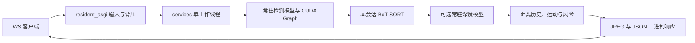

# 本机／自有服务器常驻 GPU 服务

这是用户选定的后续部署方向。新增入口 `config.resident_asgi:application` 在 ASGI startup 加载一次 GPU 模型；视频连接通过 `/ws/detect/resident/` 直接进入进程内工作线程，省去 HF 分配和 worker 回环 HTTP 交接。原入口 `config.asgi:application` 保持现有行为。

## 结构与优化工作入口

| 目录／文件 | 职责 | 推理优化关注点 |
| --- | --- | --- |
| `config/` | Django 设置、HTTP/ASGI 装配 | 常驻启动、单进程部署、Origin/Host 配置 |
| `core/` | HTTP/WS 适配、原 HF 转发、图像工具、地图和 VLM | 输入契约、排队、JPEG 编解码、外部 API 耗时 |
| `realtime/services.py` | 常驻模型、工作线程、会话所有权 | 模型一次加载、取消后等待真实推理完成 |
| `realtime/resident_asgi.py` | 新常驻二进制 WS 适配 | 顺序、12 帧背压、停止排空、忙碌拒绝 |
| `realtime/detector.py` | 单帧完整流水线 | 预处理 → 检测 → 跟踪关联 → 深度融合 → 运动/风险 → JPEG |
| `realtime/depth.py` | YOLO26 Depth 与框内深度统计 | 深度 forward、设备内 ROI 归约、CPU/GPU 同步 |
| `realtime/tracking.py`、`risk.py` | BoT-SORT、距离历史、TTC 和风险规则 | 每视频会话独立状态、时间戳、帧处理开销 |
| `zerogpu/runtime.py` | 检测模型装载及 CUDA Graph | 常驻张量、固定尺寸输入、FP32、搬运与计算计时 |
| `zerogpu/` 其余文件 | 原 HF Space、分配与 worker 传输 | 原部署兼容；不再是新常驻链路的必经路径 |
| `models/` | 模型 manifest、旧部署方案、本地权重 | SHA 身份与运行参数；权重 Git ignored |
| `tools/`、`model_tests/` | 基准、模型与质量验证 | 原始帧记录、首帧/稳态分离、数值与质量门槛 |
| `benchmarks/`、`notebooks/` | 本轮证据及历史实验 | 区分硬件、工作负载和诊断／质量评估 |
| `../frontend/` | 摄像头采集、显示、客户端协议 | 显式 Echo/HF/常驻选择，分别校验 HF 和 resident-v1 准入 |



## 启动

使用已准备的 Python 3.12 环境、本机 CUDA、`requirements-depth.txt` 依赖及经 manifest 验证的官方权重。服务不自动下载、不切换 CPU、不重试。`RESIDENT_MODE` 可为 `detection`、`depth`、`full`，默认 `full`；分别对应仅检测、检测加深度、检测加深度/跟踪/风险。它们是显式工作负载，不是运行时降级等级。

在 `backend/`，先按 README 配置 `.env` 中的 `DJANGO_SECRET_KEY`。不要覆盖已有 `.env`。本机启动：

```powershell
$env:RESIDENT_MODE = 'full'
$env:YOLO_CONFIG_DIR = "$PWD\.venv\ultralytics"
$env:YOLO_AUTOINSTALL = 'false'
$env:MPLCONFIGDIR = "$PWD\.venv\matplotlib"
New-Item -ItemType Directory -Force $env:YOLO_CONFIG_DIR, $env:MPLCONFIGDIR | Out-Null
.\.venv\Scripts\python.exe -m uvicorn config.resident_asgi:application --host 127.0.0.1 --port 8766 --workers 1 --lifespan on --ws websockets-sansio --ws-max-size 1310728 --ws-max-queue 12 --ws-per-message-deflate false
```

一次启动只构建一个检测模型和一个可选深度模型；检测 Graph 在第一张真实图片上捕获，之后跨会话复用。首帧仍需支付捕获与 SDK 初始化成本，没有用人工暖机结果隐藏该成本。深度 Graph 实验尚未接入服务。

部署到自有服务器时，显式选择对应 Django 配置和精确的 `CAMERA_ALLOWED_ORIGINS`／`ALLOWED_HOSTS`，使用 HTTPS/WSS 反向代理。与既有摄像头诊断端点一样，本接口按 Origin/Host 校验，不是产品账号认证；当前没有多租户用户鉴权。不要通过增加 Uvicorn workers 来扩容同一 GPU：模型和 admission 都是进程内状态。

## 会话与协议

- 地址：`ws://127.0.0.1:8766/ws/detect/resident/`，Origin 必须为配置的同源地址，Host 必须一致，不接受查询参数。
- 首条 JSON：`kind=session`、`protocol=resident-v1`，实际模型 SHA／FP32 身份、工作负载、`max_inflight=12`、`idle_seconds=15`、`session_seconds=null`。不宣称继承 HF FP16 的 COCO 验证成绩。
- 输入复用 `realtime.protocol.pack_request(index, jpeg)`：`PRF1` + 网络序 uint32（从 0 连续递增）+ JPEG；最多 1 MiB、最大边 640，原 JPEG80/阈值 0.25 保持。
- 输出复用 `unpack_result(packet, expected_index)`：`PRS1` + JSON 字节数 + metadata + JPEG。新增 `resident_queue_ms` 是本机接收至提交执行的等待时间，`server_ms` 包含单帧流水线；阶段计时存在包含关系，不能直接相加。
- 深度启用时，`depth_ms = decode_boxes_ms + depth_predict_ms + depth_fusion_ms`，分别记录框解析、深度调用及距离融合的主机耗时。没有额外 CUDA 同步，异步设备等待可能落在后续阶段；这些字段不能当成纯 GPU kernel 时间。
- 12 帧限制包含已接收但尚未发送完成的全部帧。客户端应在完整收到一帧后释放 credit；超过窗口或乱序直接失败，不丢帧、不重试。
- 正常停止发送精确文本 `{"kind":"stop"}`。服务排空已接收帧，再返回 `kind=ended` 及 `received/delivered`，最后正常关闭。断连则停止后续排队帧，等待已经进入工作线程的推理完成，再释放槽位。
- 一个活动视频会话。第二连接收到 `resident_busy` 和 1013，服务尚未就绪或推理故障后收到 `resident_unavailable`。模型推理故障需显式重启进程；损坏输入只终止当前会话。
- 没有 HF 的 55 秒分配上限。无输入 15 秒结束会话；发送阻塞上限 15 秒。日志记录安全的会话 ID、帧数、异常类型，不记录图像正文。
- `full` 每次连接创建全新跟踪器，清除 ID、画幅、距离历史与运动状态；同一会话应保持连续视频及画幅稳定。

原 Django HTTP、MCP 和现有 WS 路由仍由原应用处理。使用常驻入口启动后，打开 `http://127.0.0.1:8766/live/`，在处理模式中选择「常驻 GPU · 80 类」，再手动开始摄像头。默认仍为 Echo，不自动选择服务。客户端按所选模式校验 hello：常驻必须是 `resident-v1`／FP32／明确工作负载，不接受 HF 的 55 秒分配契约或附带的质量声明；HF 原校验保留。完整模式要求每帧都有深度、跟踪、风险字段；正常结束计数必须覆盖全部请求。

页面保持原最大边 640、JPEG80、首帧单独完成、之后 30FPS 采样上限和 12 个在途作业；采样上限不等于实交付速率。用户点击停止、隐藏页面或出现错误会取消客户端未完成工作并释放摄像头；服务端等待实际正在执行的推理结束。`/api/health/` 仍检查数据库，不代表 GPU 可用；常驻启动日志及 WS admission 才描述本服务状态。

## 复现实测

下列工具自行启动临时回环 ASGI 服务，一次模型加载，按 12、24 FPS 各发送 10 秒，换输入后再重连；不需另开服务器。保留全部 metadata/JPEG 哈希、请求/交付计数、首帧、稳态、排队、发送迟到及显存。已有输出目录会拒绝覆盖。

```powershell
.\.venv\Scripts\python.exe -m tools.benchmark_resident --mode full --fps 12 24 --seconds 10 --reconnect-input models/experiments/coco8/images/val/000000000036.jpg --output benchmarks/NEW_RUN/resident-full
```

这是固定图片重复传输的 GPU/协议诊断，不是移动视频或深度质量评估。原传输门槛仍为至少 10 FPS 且最大稳态延迟不超过 500ms；不通过时保留报告并返回非零状态。FP32、检测 640、深度 768、阈值、数据集和质量门槛均未修改。

结果、限制和检查记录持续写入 [推理优化计划](INFERENCE_OPTIMIZATION_PLAN.md)。

## 浏览器验证与数据交接（2026-10-18）

`tools/benchmark_resident_browser.mjs` 自行启动本机 8766 端口服务和无头 Chrome，使用静态公开公交图的 canvas MediaStream 替代传感器，实际执行页面选择、JPEG 编码、二进制校验、GPU 推理、图片解码和 HUD。仅将每次测试限制为 181 帧；采样 30FPS、窗口 12 和模型处理均保持原条件。工具需要 `PRS_PLAYWRIGHT_PATH` 指向现有 Playwright 包，且输出目录必须不存在：

```powershell
node tools/benchmark_resident_browser.mjs benchmarks/NEW_RUN/browser-resident
```

本轮 Chrome 155 完成两次 181/181 帧显示、忙碌拒绝、重连及停止释放，页面无未捕获异常。首次视频帧 6007ms，重连首帧 57.1ms，第二会话无 Graph 重建。两次稳态显示 19.26／21.01FPS，采集至解码 P95 761.64／617.35ms，最大 787.8／636.4ms，**均未达到原每帧 ≤500ms 门槛**。完整功能链路通过不能写成性能验收通过；没有改低采样率、删慢帧或启用深度 Graph 来掩盖排队。

报告及全部帧：[browser-resident-draw/report.json](benchmarks/2026-10-18/browser-resident-draw/report.json)；精简统计：[summary.json](benchmarks/2026-10-18/browser-resident-draw/summary.json)。首次测试因静态画布订阅后没有继续绘制而停在视频启动，未发出推理请求；修正测试供帧后通过，原失败保留。工具在 Windows 上终止自己的测试子进程，不将此操作称为 ASGI 优雅关闭验证；关闭协议的证据仍为后端测试及先前60秒服务实验。

深度 Graph 新诊断使用现有公交图和原 COCO8 四张验证图，按正序再逆序共 10 次；对每种实际张量形状显式建立实验 Graph，检查切换输入／复用后的原始深度、检测哈希、框和距离、完整 JPEG。全部完全一致、最大深度差 0；见 [多输入报告](benchmarks/2026-10-18/depth-multi-input/report.json)。未下载或重新划分数据，未把五张图当成准确率评估，默认服务未启用此候选。

真实视频及深度／距离真值由同事负责，目前未准备。接入后需记录视频时间戳/帧率/画幅、RGB与米制深度配对和有效掩码、既定数据划分及评估协议；保持当前实验参数与质量门槛。移动场景跟踪/风险质量、真机与公网、多用户吞吐和远程部署仍未验证。

## 排队与融合诊断（2026-10-19）

已保存浏览器重连样本的服务处理 P50 为45.30ms、排队 P50 为503.38ms，解释了30FPS采样下的窗口积压。本轮新增上述分阶段计时，并单独实验 GPU ROI 排序中位数：五张样例正反序10次对照、465次独立融合均完全一致，但排序在五张图中的四张更慢；完整链路候选 P50 48.63ms，前后对照47.73／44.42ms。因此保留默认融合实现，候选仅在 `tools/` 显式调用，未接入服务。

复现步骤与全部证据见 [计划的本日记录](INFERENCE_OPTIMIZATION_PLAN.md#2026-10-19-排队归因与-roi-融合实验) 和 [实验汇总](benchmarks/2026-10-19/summary.json)。本轮未重跑实际浏览器或改变任何性能门槛，不宣称页面延迟改善。

2026-10-20又独立验证了复用官方深度 predictor、跳过逐帧配置重建的候选。五张图的十次数值对照完全一致，配置开销 P50 从约0.23–0.24ms降至0.035ms，但原实现整帧前后波动大，未证实稳定整帧收益，因此仍不接入默认服务。复现、首帧成本与完整证据见 [SDK实验记录](INFERENCE_OPTIMIZATION_PLAN.md#2026-10-20-深度-sdk-调用开销实验)。

## 深度 Graph 独立服务实验（2026-10-20）

`tools/benchmark_resident_browser.mjs OUTPUT_DIR --depth-graph` 显式选择仅供本机诊断的 `tools.resident_graph_asgi`，默认服务入口不变。实验在首张真实帧计算后捕获一次Graph，准备耗时计入首帧响应，重连复用；形状变化失败，不自动捕获新形状或回退。没有叠加其他候选，也未放宽30FPS／12窗口或500ms门槛。

三组实际浏览器对照共显示1086帧，Graph稳态21.28–22.82FPS，对照17.40–17.80FPS；Graph两次最大延迟555／601ms，**仍未通过500ms门槛**。首次准备466.25ms，重连准备0ms；候选仍未纳入默认服务。细节、逐帧数值／时间相关标注差异及限制见 [服务实验记录](INFERENCE_OPTIMIZATION_PLAN.md#2026-10-20-深度-graph-独立服务与浏览器实验)。浏览器工具将功能完成与性能通过分开记录，退出2表示性能门槛未满足。
